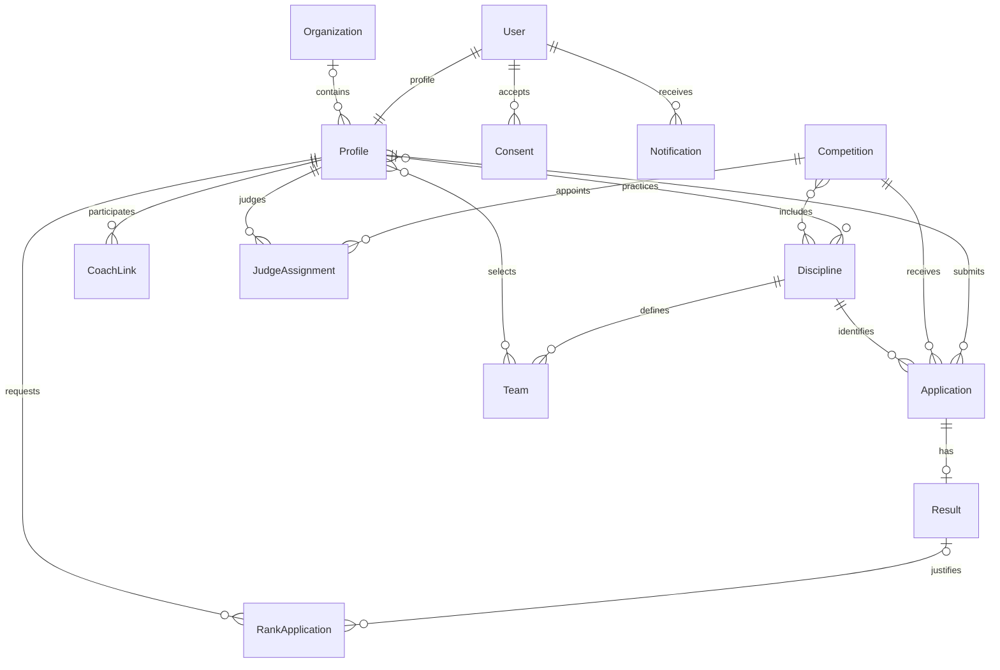

# Устройство приложения и интерфейсы

## Стек и структура

Монолит Django 5.2 на Python 3.12: сервер формирует HTML через Django Templates, CSS и JavaScript подключаются из локальной статики. Это позволяет запускать демо без Node.js и отдельных frontend-сервисов. SQLite хранит данные локальной разработки. XLSX, DOCX и PDF формируются внутри процесса без внешнего сервиса документов.

| Файл/каталог | Ответственность |
| --- | --- |
| `config/settings.py` | Среда, БД, сессии, почтовый backend, пути приватных загрузок |
| `federation/models.py`, `migrations/` | Сущности, ограничения и миграции |
| `federation/forms.py` | Проверка пользовательского ввода, доступные спортсмены, дисциплины и результаты |
| `federation/access.py` | Активная роль и права на персональные карточки |
| `federation/views.py`, `urls.py` | HTML-процессы, смена состояний, выгрузки и небольшой JSON API |
| `federation/services.py` | Рейтинг, численность, уведомления и журнал действий |
| `federation/documents.py` | Генерация демонстрационных табличных документов |
| `federation/management/commands/` | Идемпотентное демо-наполнение и периодические напоминания |
| `federation/templates/`, `static/` | Адаптивный русский интерфейс |

## Основные связи данных

`Profile.roles` — список ролей аккаунта. `CoachLink` различает тренера и спортсмена, всегда содержит дисциплину и статус. `RankApplication` хранит как запрос, так и решение с датой, сроком и приказом; для спортивного разряда обязателен конкретный результат. Для судейской категории результат спортсмена не используется. Самостоятельная сущность протокола не нужна для этого MVP: опубликованный протокол строится из результатов соревнования с флагом `protocol_published`. Правила призовых баллов хранятся в `RatingRule`; рейтинг рассчитывается по опубликованным результатам, а сохранённая сборная — в `Team`.

`Consent` сохраняет версию и время согласия, для несовершеннолетнего — имя представителя. `AuditLog` хранит пользователя, активную роль, время, действие, объект и подробности. Технические правки напрямую в БД или Django admin не проходят через журнал бизнес-действий.

## Авторизация и границы доступа

Вход реализован средствами Django: пароль в виде хэша, сессионная cookie, CSRF-защита изменяющих запросов и экранирование шаблонов. Активная роль хранится в сессии; при каждом обращении она сверяется с ролями профиля. Нельзя получить дополнительные полномочия, передав в запросе неназначенную роль. При переключении аккаунт с ролью федерации временно имеет только полномочия выбранного кабинета.

Федерация управляет процессами. Спортсмен видит свою приватную карточку и может подавать заявки за себя. Тренер управляет только спортсменами с подтверждённой связью, а заявки за них подаёт только по дисциплине этой связи. Судья работает со своей категорией и видит назначения. Общие календарь и краткий реестр доступны после входа; приватные карточки, согласия и персональные выгрузки дополнительно проверяют права на конкретный ресурс. Отчёт по численности и документы сборной доступны федерации. Положения выдаются через авторизованный обработчик, а не публичный `MEDIA_URL`.

Django admin — отдельный технический интерфейс разрешений Django, создаваемый через `createsuperuser`. Демо-аккаунт федерации не является staff/superuser. Технический администратор не должен использоваться вместо ролевых кабинетов.

## Инварианты процессов

- Возраст проверяется на дату соревнования. Подача заявки разрешена только в интервале регистрации открытого соревнования, по дисциплине участника; повторная заявка по той же дисциплине запрещена.
- Результат вводится только для одобренной заявки. Место уникально внутри дисциплины соревнования.
- Перед публикацией должны быть рассмотрены все заявки и введены результаты всех допущенных участников. Опубликованный протокол закрывает изменение результатов, модерацию и изменение сведений соревнования через пользовательские процессы.
- Заявка на разряд ссылается на собственный результат опубликованного протокола. Одобрение требует даты, срока и номера приказа. Нормативы ЕВСК автоматически не проверяются.
- В рейтинг сезона попадают опубликованные результаты по выбранной дисциплине. Призовые баллы суммируются, минимум два призовых старта дают коэффициент 1,2. Активная дисквалификация исключает спортсмена; подбор сборной проверяет принадлежность участников рейтингу.
- Численность рассчитывается по интервалам занятий; организация и дисциплина при фильтрации берутся из текущего профиля. Это приближение, не история зачислений и переводов.

Проверки разделены между формами, представлениями и `Model.clean()`. Прямой вызов ORM `save()` не вызывает автоматически `full_clean()` и не заменяет проверку прав приложения. Для штатных действий используйте пользовательские процессы.

## HTTP-интерфейсы

JSON API в этом MVP не повторяет эскиз полного API исходного кейса. JWT, refresh-токены, API-ключи, OIDC и внешние интеграции не реализованы.

`GET /api/v1/competitions/?page=1` требует действующую сессию Django. Ответ содержит `count`, `page` и `results` с полями `id`, `title`, `starts_on`, `ends_on`, `state`, `level`, `protocol_published`. Размер страницы — 25; черновики видит только активная роль федерации. Неавторизованный запрос перенаправляется на вход, изменяющие методы возвращают `405`.

Основные HTML-обработчики принимают обычные поля формы; POST-запросам нужен CSRF-токен:

| Метод и путь | Назначение |
| --- | --- |
| `GET/POST /register/`, `/login/` | Регистрация и вход |
| `POST /logout/`, `/switch-role/` | Выход и переключение роли |
| `GET /competitions/`, `GET/POST /competitions/new/` | Календарь и создание соревнования |
| `GET /competitions/{id}/` | Карточка, заявки, судьи и результаты |
| `POST /competitions/{id}/action/` | Состояния: `action=open`, `close`, `publish` |
| `POST /competitions/{id}/apply/` | Заявка спортсмена/тренера |
| `POST /applications/{id}/moderate/` | Решение `approved`/`rejected` с комментарием |
| `POST /competitions/{id}/results/`, `/judges/` | Результаты и назначения |
| `GET/POST /qualifications/` | Список квалификаций и новый запрос |
| `POST /qualifications/{id}/review/` | Решение по разряду/категории |
| `GET/POST /coaching/` | Тренерские связи; POST создаёт запрос привязки |
| `POST /coaching/{id}/status/` | Подтверждение, приостановка и завершение связи |
| `GET /rating/`, `POST /teams/new/` | Расчёт рейтинга и сохранение сборной |
| `GET /reports/`, `/notifications/`, `/audit/`, `/guide/` | Отчёты, уведомления, журнал и навигатор |
| `GET /documents/{kind}/{id}/{fmt}/` | Выгрузка: `kind=protocol/team/athlete/census/consent`, `fmt=xlsx/docx/pdf` |
| `GET /health/` | Проверка процесса и доступа к таблице БД, без авторизации |

В выгрузке численности `id` не используется: передайте `0`; фильтры — `year_from`, `year_to`, `discipline`, `org`. Для рейтинга используются `season`, `discipline`, `age_min`, `age_max`, `min_rank`; значение минимального разряда должно совпадать с названием в форме. Даты передаются в ISO-формате `YYYY-MM-DD`. Ответы выгрузок имеют `Cache-Control: private, no-store`.

## Уведомления, повторный запуск и развёртывание

Уведомление сначала записывается в БД. Почта отправляется после успешного завершения транзакции; отказ почтового транспорта не удаляет уведомление кабинета. По умолчанию письма сохраняются в `.local/mail/`. SMTP можно подключить переменными окружения, но внешняя доставка не настроена и требует отдельной проверки. Команда `send_reminders` должна запускаться планировщиком и не создаёт одинаковые сообщения при последовательных повторных запусках. Отдельного надёжного почтового outbox/очереди повторных отправок в MVP нет.

Снимок файлов сохраняет БД и зависимости, но не живые процессы. После восстановления требуется заново запустить сервер и планировщик. Установка, запуск, резервное копирование, границы MVP и параметры среды описаны в [README](../README.md). Официальные формы и юридические требования к внедрению требуют отдельного согласования; эта демонстрация не подтверждает промышленную готовность или соответствие законодательству о персональных данных.
