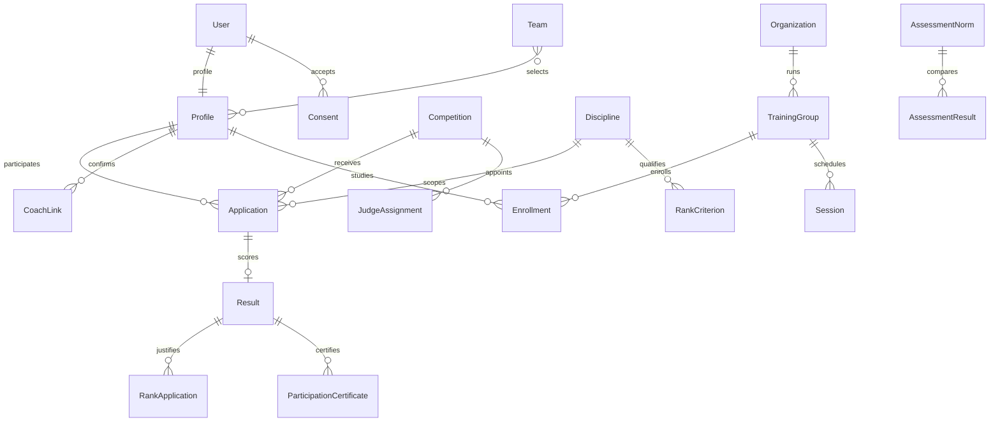

# Архитектура и границы доступа

## Компоненты

Django на Python 3.12 обслуживает серверные HTML-страницы и REST API. CSS и JavaScript локальные; Node.js для запуска не требуется. SQLite предназначен для простой локальной демонстрации, PostgreSQL — для серверного развёртывания. Экспорт XLSX/DOCX/PDF и QR выполняется внутри приложения.

| Приложение | Ответственность |
| --- | --- |
| `federation` | Профили и роли, согласия, соревнования, заявки, результаты, квалификации, рейтинг, сборная, численность, аудит, справочники и настройки документов |
| `identity` | OIDC/ФСП ID, code+PKCE, согласие, claims и тестовый клиент |
| `integrations` | REST/JWT, ограниченные партнёрские токены, импорт и очередь вебхуков |
| `training` | Программы, группы, интервалы зачисления, занятия и посещаемость, нормативы, результаты и перевод по аттестации |
| `governance` | Апелляции, доказательства, версии исправления результатов, нарушения, премии и кабинет министерства |
| `development` | Показатели и источники, критерии разрядов и путь спортсмена, QR-справки, судейские документы |

`config/settings.py` читает окружение процесса. Загрузка произвольного `.env` не выполняется. Gunicorn обслуживает WSGI, WhiteNoise — собранную статику; закрытые загрузки выдаются представлениями с проверкой роли. Веб-приложение и планировщик запускаются разными процессами.

## Основные связи

Протокол строится из одобренных заявок и результатов соревнования. Публикация фиксирует обычное редактирование; изменение после публикации выполняется отдельным процессом апелляции с сохранением версии и причины. QR-справка сохраняет отдельный снимок сведений и отпечаток источника: исправление результата не переписывает старую справку, а делает её недействительной.

Учебная история отделена от текущего профиля. Зачисление содержит интервал, организацию/дисциплину через группу, этап, муниципалитет и другие необходимые снимки. Перевод закрывает прежний интервал, создаёт новый и сохраняет доказательства аттестации. Численность считает уникальных спортсменов по годам и выбранному разрезу; старые профили без зачислений используют явно обозначенный резервный способ учёта.

## Авторизация

В HTML используется сессионная авторизация Django, хэширование паролей и CSRF-защита. Активная роль сверяется с текущими ролями профиля. API поддерживает JWT и сессионную авторизацию; роль и область доступа проверяются на каждом запросе. Самостоятельная регистрация не даёт роль федерации или министерства.

| Активная роль | Граница |
| --- | --- |
| Федерация | Управление бизнес-процессами и справочниками |
| Спортсмен | Собственные заявки, профиль, результаты, справки и согласия |
| Тренер | Подтверждённые спортсмены; подача заявок и документов только по дисциплине связи |
| Судья | Свои категории, назначения и история судейства |
| Министерство | Только чтение разрешённых отчётов, календаря и состава сборной |

OIDC выдаёт сведения по согласованным scopes; частные данные профиля не должны попадать в публичные claims автоматически. Приватный ключ хранится вне Git и сохраняется между перезапусками. Партнёрский доступ отделён от интерактивной сессии и ограничен scope, сроком и отзывом токена. Детали точных маршрутов и полей: [API](api.md) и [ФСП ID](identity.md).

Публичны навигатор новичка, стандартные OIDC-метаданные и минимальная проверка UUID справки. Проверка справки не раскрывает фамилию полностью, дату рождения, контакты или законного представителя. Закрытые документы, доказательства и личные карточки требуют проверки конкретного ресурса, а не только факта входа.

Django admin — отдельный технический интерфейс разрешений Django. Он не заменяет пользовательские процессы; прямые ORM/admin-правки не проходят через их аудит. `Model.save()` не вызывает `full_clean()` автоматически: для штатных изменений используются формы, сервисы и представления.

## Инварианты

- Соревнования, заявки, тренерские связи, результаты и рейтинг сохраняют дисциплину. Возраст допуска рассчитывается на начало соревнования.
- Заявка допустима только в открытом интервале регистрации, для действующего спортсмена и разрешённой дисциплины. Повтор по той же паре спортсмен/дисциплина запрещён.
- Результат существует только для одобренной заявки; места различаются внутри дисциплины соревнования. Публикация требует рассмотрения всех заявок и результатов всех допущенных участников.
- Разряд ссылается на конкретный опубликованный результат. Решение требует приказа, даты и срока. Подсветка кандидата не заменяет нормативное решение.
- Рейтинг учитывает сезон и дисциплину; ×1,2 применяется за призовые места на двух разных соревнованиях. Действующее отстранение исключает спортсмена. Состав сборной проверяется по выбранным фильтрам рейтинга.
- Посещаемость возможна только для спортсмена, зачисленного на дату занятия. Перевод по аттестации требует выполнения всех обязательных подходящих нормативов.
- Исправление опубликованного протокола требует отдельного решения с основанием и сохранения старых сведений.
- Публичная справка действительна только при совпадении сохранённого отпечатка с текущим источником и отсутствии отзыва. Повторная выдача отзывает старый номер.
- Секреты, реальные документы ПДн и OIDC-ключ не включаются в исходники или демо-наполнение.

## Уведомления и интеграции

Сначала фиксируется внутреннее уведомление. Отправка письма выполняется после транзакции и не отменяет бизнес-действие при отказе SMTP. Состояния, аренда обработчика и повторные попытки хранятся в БД. `local` означает локальный backend, `sent` — принятие SMTP-сервером; это не подтверждение прочтения получателем.

Вебхуки используют отдельную очередь, подпись и повтор. Сетевые назначения ограничены разрешёнными HTTPS-хостами; произвольные адреса пользователя не должны превращаться в запросы к внутренним сервисам. Наличие события в очереди и фактическая доставка проверяются отдельно.

`run_scheduler` обрабатывает почту и вебхуки, формирует ежедневные напоминания. Это живой процесс; после восстановления облачного снимка его запускают заново. Подробности: [почта](mail.md), [развёртывание](deployment.md).

## Проверка и эксплуатация

Миграции версионируют структуру данных. `seed_full_demo` повторяемо добавляет вымышленные примеры всех модулей, `prepare_project` — только базовые справочники и макеты. Тесты используют отдельную БД; CI предусматривает SQLite/Windows/Ubuntu и PostgreSQL. Состояние удалённого CI нельзя выводить из наличия YAML.

PostgreSQL, HTTPS reverse proxy, реальные SMTP-реквизиты, домен и хостинг настраивает владелец размещения. Сохранение кода в GitHub не публикует Django-сайт. Перед внедрением нужны проверка актуальных нормативов, официальных форм, ПДн, резервных копий и восстановления; программная демонстрация не является юридической экспертизой.
